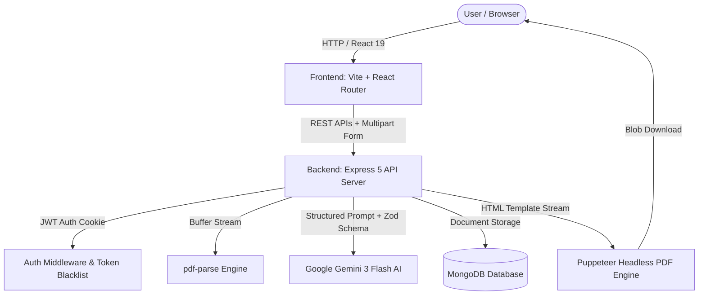

# PrepAI — AI Interview Intelligence & Strategy Studio

[](https://react.dev/)
[](https://vitejs.dev/)
[](https://nodejs.org/)
[](https://expressjs.com/)
[](https://www.mongodb.com/)
[](https://ai.google.dev/)
[](https://pptr.dev/)

An enterprise-grade, full-stack AI platform designed to transform job descriptions and candidate resumes into customized, high-probability interview intelligence reports. Powered by Google's **Gemini 3 Flash**, the system synthesizes role-tailored technical questions, STAR behavioral frameworks, skill gap diagnosis, day-by-day preparation roadmaps, and automated ATS-friendly resume generation.

---

## Architecture Overview



---

## Key Features

### 1. Multi-Modal Profile Ingestion
- **Resume PDF Extraction**: In-memory parsing of candidate resumes via `pdf-parse` (supports up to 5 MB documents).
- **Flexible Profile Inputs**: Accepts both structured PDF resumes and free-form candidate self-descriptions.
- **Drag & Drop Workspace**: Responsive dropzone with instant file validation, size indicator, and preview cards.

### 2. AI Interview Intelligence Report
- **Technical Questions**: Tailored questions targeting core competencies, featuring:
  - **Interviewer Intention**: Reveals what the interviewer is assessing behind each question.
  - **Framework & Model Answers**: Architectural concepts, edge cases, and best-practice solutions.
  - **1-Click Copy**: Instant clipboard copy action for question tracking.
- **Behavioral Questions**: Scenario-based questions built around the STAR framework (Situation, Task, Action, Result).
- **Diagnosed Skill Gaps**: Categorized by severity (`High`, `Medium`, `Low`) to pinpoint high-risk knowledge gaps.
- **Preparation Road Map**: Structured day-by-day milestones with focused topics and actionable checklist items.
- **Profile Alignment Gauge**: Circular percentage match score indicating candidate-to-role suitability.

### 3. Automated ATS Resume PDF Generator
- On-demand AI generation of ATS-optimized resume HTML based on role alignment and candidate credentials.
- Headless PDF compilation via **Puppeteer**, producing clean, single/dual-page vector PDFs ready for download.

### 4. Authentication & Security
- Secure cookie-based authentication with **JWT** (`jsonwebtoken`).
- Password hashing with **Bcrypt.js** (10 salt rounds).
- Database-backed token blacklisting for safe logout revocation.
- CORS credentialed origin isolation (`http://localhost:5173`).

### 5. Modern Studio UI & Design System
- Custom dark-mode SaaS aesthetic (`#0d1117` base, `#161b22` cards, `#ff2d78` neon rose gradient accents).
- Connected Google Fonts: [Plus Jakarta Sans](https://fonts.google.com/specimen/Plus+Jakarta+Sans) for headings and [Inter](https://fonts.google.com/specimen/Inter) for body copy.
- Fluid responsive layout with animated glowing ambient backdrops and micro-animations.

---

## Tech Stack

| Layer | Technology | Purpose |
|---|---|---|
| **Frontend Framework** | React 19 + Vite 7 | Lightning-fast development and build bundling |
| **Routing & State** | React Router 7 + Context API | Client-side routing and reactive global state |
| **Styling** | Sass (SCSS) + CSS Custom Properties | Modular styling, Dart Sass modern module system |
| **HTTP Client** | Axios (Credentials enabled) | Cookie-based REST API communication |
| **Backend Runtime** | Node.js + Express 5 | Scalable REST API microservices |
| **AI Engine** | Google GenAI SDK (`gemini-3-flash-preview`) | Structured JSON generation using Zod schemas |
| **Database** | MongoDB Atlas + Mongoose 9 | Persistent schema validation and document storage |
| **PDF Processing** | `pdf-parse` + Puppeteer | Resume text extraction and vector PDF rendering |
| **File Handling** | Multer (Memory Storage) | Multi-part form-data buffer handling |

---

## Directory Structure

```text
GenAI-Full-Stack/
├── Backend/
│   ├── src/
│   │   ├── config/
│   │   │   └── database.js          # MongoDB connection handler
│   │   ├── controllers/
│   │   │   ├── auth.controller.js   # User registration, login, logout, me
│   │   │   └── interview.controller.js # Report generation, fetching & PDF export
│   │   ├── middlewares/
│   │   │   ├── auth.middleware.js   # JWT verification & blacklist validation
│   │   │   └── file.middleware.js   # Multer memory storage configuration
│   │   ├── models/
│   │   │   ├── user.model.js        # User account schema
│   │   │   ├── blacklist.model.js   # Revoked token blacklist
│   │   │   └── interviewReport.model.js # Structured interview intelligence report
│   │   ├── routes/
│   │   │   ├── auth.routes.js       # /api/auth endpoints
│   │   │   └── interview.routes.js  # /api/interview endpoints
│   │   ├── services/
│   │   │   └── ai.service.js        # Google Gemini 3 Flash & Puppeteer pipeline
│   │   └── app.js                   # Express application setup & middleware
│   ├── server.js                    # Server entry point (Port 3000)
│   ├── package.json
│   └── .env                         # Backend environment variables
│
├── Frontend/
│   ├── public/                      # Static assets
│   ├── src/
│   │   ├── features/
│   │   │   ├── auth/                # Authentication module (pages, hooks, context)
│   │   │   │   ├── auth.context.jsx
│   │   │   │   ├── auth.form.scss
│   │   │   │   ├── hooks/useAuth.js
│   │   │   │   ├── pages/Login.jsx
│   │   │   │   └── pages/Register.jsx
│   │   │   └── interview/           # Core studio module
│   │   │       ├── hooks/useInterview.js
│   │   │       ├── interview.context.jsx
│   │   │       ├── pages/Home.jsx       # Studio configuration dashboard
│   │   │       ├── pages/Interview.jsx  # Detailed intelligence report view
│   │   │       ├── services/interview.api.js
│   │   │       └── style/
│   │   │           ├── home.scss
│   │   │           └── interview.scss
│   │   ├── app.routes.jsx           # Protected application routing
│   │   ├── App.jsx                  # Root context providers
│   │   ├── main.jsx                 # Vite application mount point
│   │   └── style.scss               # Global design tokens and typography
│   ├── index.html                   # HTML template with Google Fonts
│   ├── vite.config.js
│   └── package.json
│
└── README.md
```

---

## API Endpoints

### Authentication (`/api/auth`)

| Method | Endpoint | Access | Description |
|---|---|---|---|
| `POST` | `/api/auth/register` | Public | Register a new user (`username`, `email`, `password`) |
| `POST` | `/api/auth/login` | Public | Authenticate user and issue HTTP-only JWT cookie |
| `GET` | `/api/auth/logout` | Protected | Blacklist JWT token and clear authentication cookie |
| `GET` | `/api/auth/me` | Protected | Fetch current logged-in user profile |

### Interview Studio (`/api/interview`)

| Method | Endpoint | Access | Description |
|---|---|---|---|
| `POST` | `/api/interview/` | Protected | Generate report from `jobDescription`, `selfDescription`, and `resume` PDF |
| `GET` | `/api/interview/` | Protected | Retrieve all historical interview reports for user |
| `GET` | `/api/interview/report/:interviewId` | Protected | Fetch specific interview report by ID |
| `POST` | `/api/interview/resume/pdf/:interviewReportId` | Protected | Generate and stream ATS-tailored resume PDF |

---

## Getting Started

### Prerequisites
- **Node.js** (v18.0 or higher recommended)
- **npm** (v9.0 or higher)
- **MongoDB** connection string (Local or MongoDB Atlas)
- **Google Gemini API Key** (from [Google AI Studio](https://aistudio.google.com/))

---

### Step 1: Clone Repository

```bash
git clone https://github.com/Alriyan1/GenAI-Full-Stack.git
cd GenAI-Full-Stack
```

---

### Step 2: Configure and Run Backend

1. Navigate to the backend directory:
   ```bash
   cd Backend
   ```

2. Install dependencies:
   ```bash
   npm install
   ```

3. Create a `.env` file in the `Backend/` folder:
   ```env
   PORT=3000
   MONGO_URI=mongodb+srv://<username>:<password>@cluster0.mongodb.net/prepai
   JWT_SECRET=your_super_secret_jwt_key_here_minimum_32_characters
   GOOGLE_GENAI_API_KEY=your_google_gemini_api_key_here
   ```

4. Start the backend development server:
   ```bash
   npm run dev
   ```
   *The backend will boot up at `http://localhost:3000` with automated database connection.*

---

### Step 3: Configure and Run Frontend

1. Open a new terminal and navigate to the frontend directory:
   ```bash
   cd Frontend
   ```

2. Install dependencies:
   ```bash
   npm install
   ```

3. Start the Vite development server:
   ```bash
   npm run dev
   ```

4. Open [http://localhost:5173/](http://localhost:5173/) in your web browser.

---

## Production Build

To verify and bundle the frontend for production:

```bash
cd Frontend
npm run build
```

This compiles optimized client bundles into the `Frontend/dist/` directory.

---

## Contributing

1. Fork the repository
2. Create your feature branch (`git checkout -b feature/AmazingFeature`)
3. Commit your changes (`git commit -m 'Add some AmazingFeature'`)
4. Push to the branch (`git push origin feature/AmazingFeature`)
5. Open a Pull Request

---

